# 破局 Breakout - 轻量级阻塞驱动任务管理系统

基于 PRD 需求实现的轻量、阻塞驱动、AI辅助闭环的任务管理系统。

## 技术栈

| 层级 | 技术 |
|------|------|
| 后端 | GoFrame + GORM + MySQL 8.0 |
| 前端 | Vue 3.5 + Element Plus 2.8 + Vite 5 |
| 图表 | ECharts 5 + vue-echarts |
| 小程序 | 微信原生开发（WXML + WXSS） |
| 数据库 | MySQL 8.0（Docker） |

## 快速开始

### 方式一：一键启动

```bash
chmod +x start.sh
./start.sh
```

### 方式二：手动启动

1. **启动 MySQL**

```bash
docker run -d --name teampanel-mysql \
  -p 3306:3306 \
  -e MYSQL_ROOT_PASSWORD=123456 \
  -e MYSQL_DATABASE=teampanel \
  -v ./backend/sql/init.sql:/docker-entrypoint-initdb.d/init.sql \
  mysql:8.0
```

2. **启动后端**

```bash
cd backend
go build -o breakout .
./breakout   # 默认端口 8080
```

3. **启动前端**

```bash
cd frontend
npm install
npm run dev   # 默认端口 5173
```

4. **访问**

- 前端：http://localhost:5173
- 后端API：http://localhost:8080/api/v1

### 测试账号

| 手机号 | 密码 | 角色 |
|--------|------|------|
| 13800000001 | 123456 | 所有者 |

## 功能模块

### 核心功能

- **仪表盘**：阻塞地图摘要、项目概览、任务状态/优先级分布图表
- **项目管理**：项目CRUD、项目面板（任务树+进度+成员管理）
- **任务管理**：任务CRUD、父子任务树、筛选排序、批量操作
- **看板**：6列状态看板（待办/进行中/待复核/待验收/已完成/已关闭），支持拖拽
- **甘特图**：时间轴视图、任务进度条、风险高亮、今日线
- **阻塞地图**：风险评分排序、高/中/低风险统计、快捷解除阻塞
- **周报**：AI生成周报、查看、导出
- **团队管理**：团队成员列表、邀请成员、角色管理
- **通知中心**：通知列表、已读/未读、批量操作

## 系统展示

### PC 管理端（Vue 3 + Element Plus）

采用 Art Design Pro 设计风格，主色 #4d7bfe，提供完整的项目与任务管理能力。

**登录页** — 支持手机号登录，Art Design Pro 风格卡片布局


**仪表盘** — 阻塞地图摘要、项目概览、任务状态/优先级分布图表

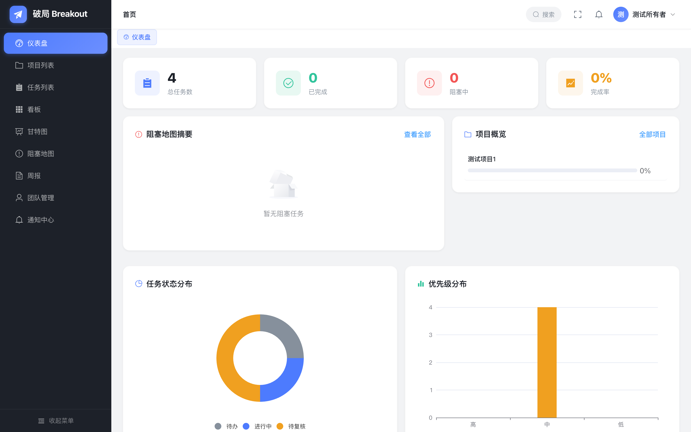

**项目管理** — 项目列表与项目面板（任务树、进度、成员管理）

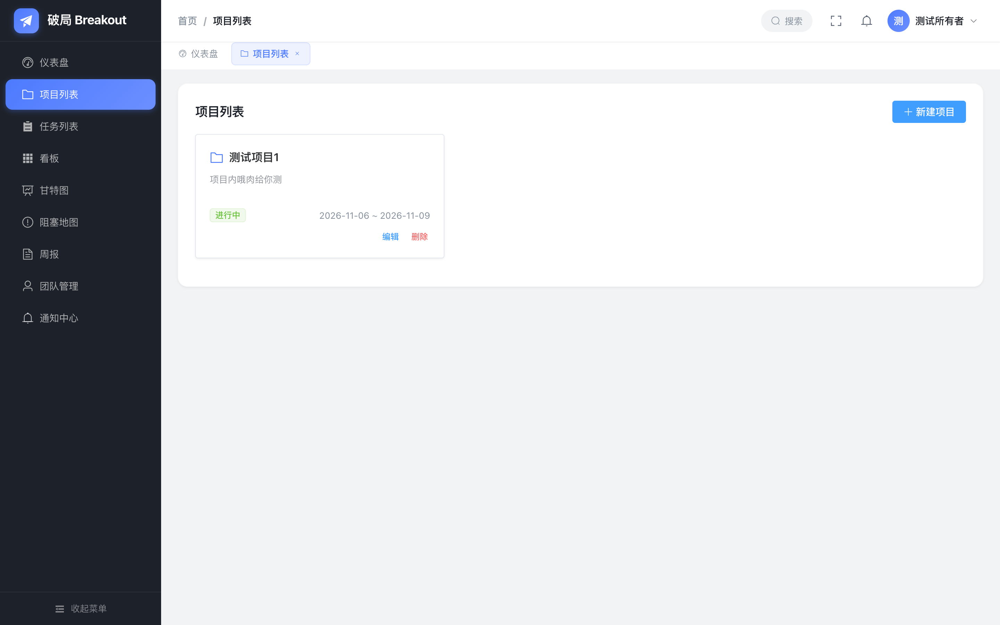

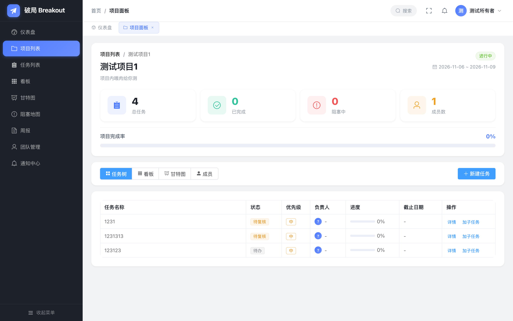

**任务管理** — 列表/看板/甘特图三种视图，支持拖拽与筛选

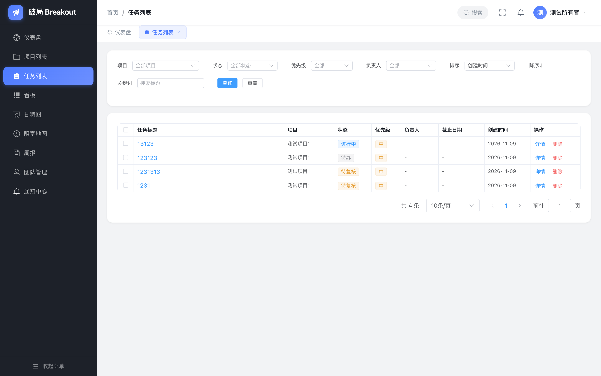

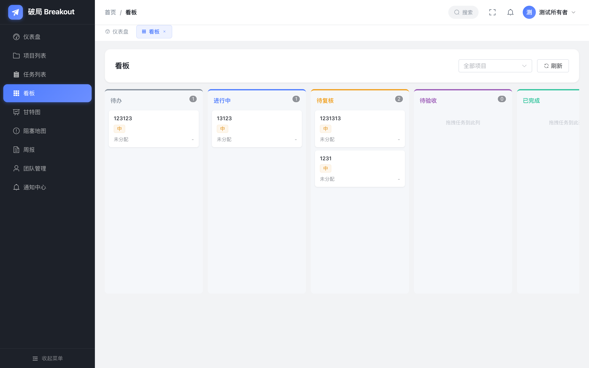

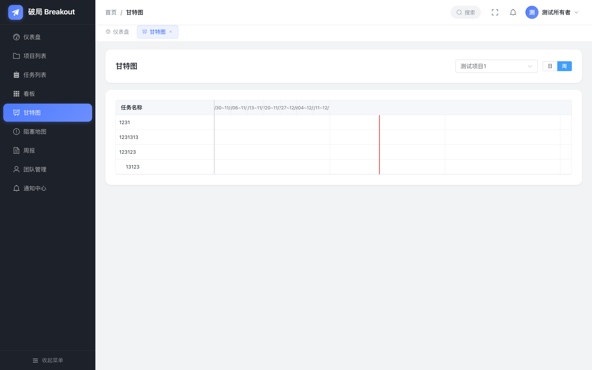

**阻塞地图** — 风险评分排序，高/中/低风险统计，快捷解除阻塞

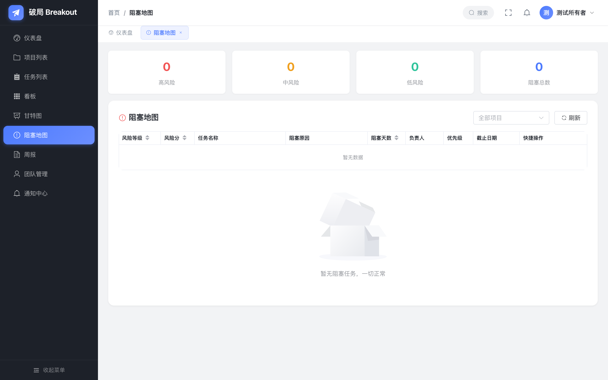

**统计周报** — AI 生成周报，数据可视化

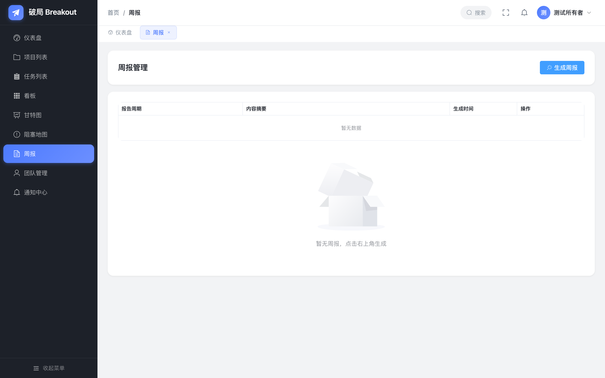

**团队管理** — 成员列表、邀请成员、角色管理

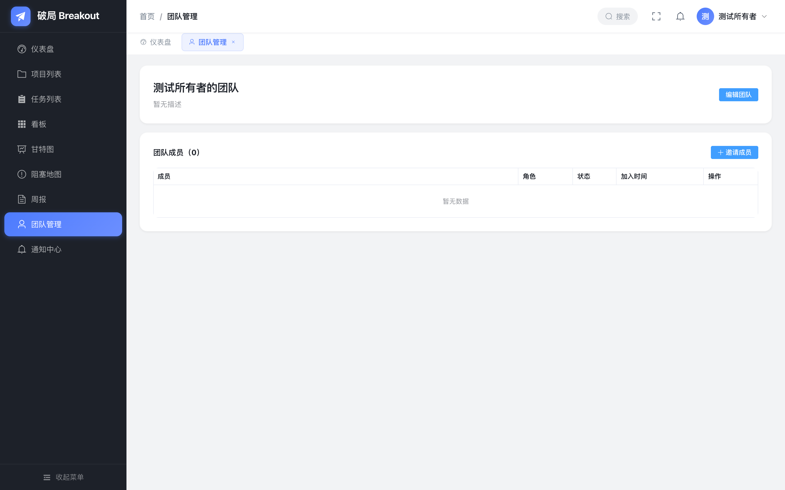

**通知中心** — 通知列表、已读/未读筛选

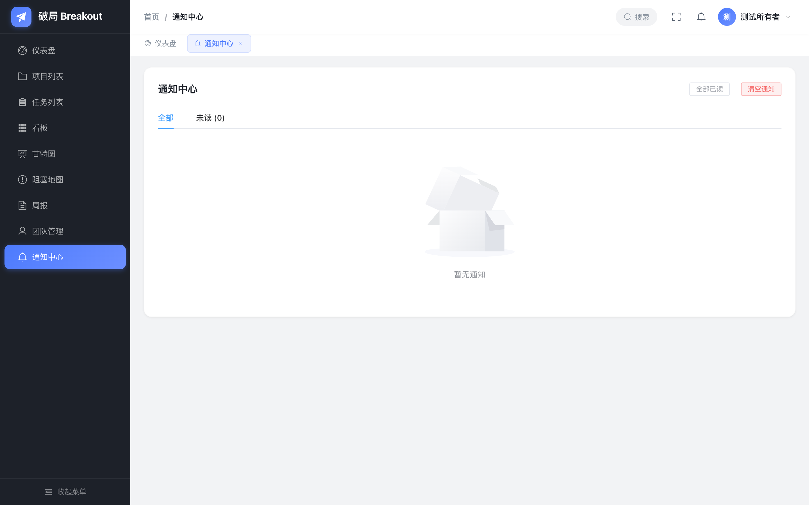

### 微信小程序端（原生开发）

与 PC 端共享同一套后端 API，支持微信登录与手机号登录，随时随地处理任务。

**登录页** — 微信一键登录 + 手机号登录

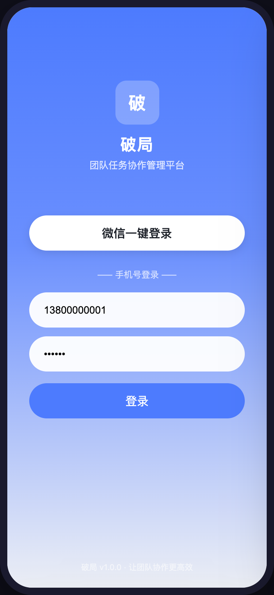

**首页** — 任务统计、阻塞预警、最近任务、我的项目

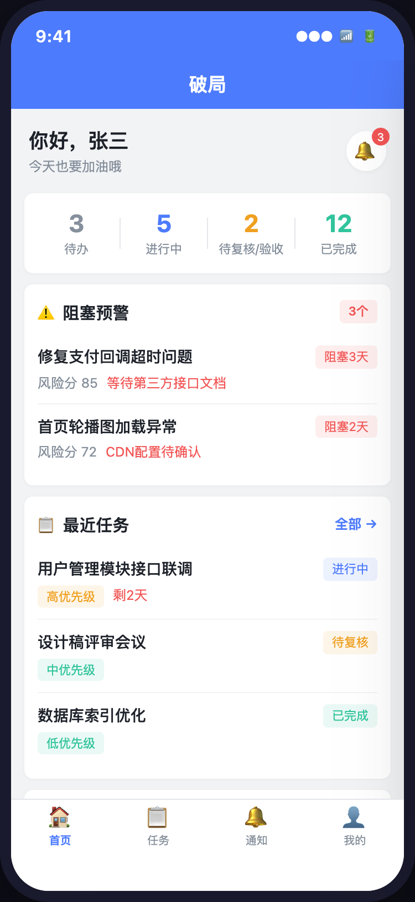

**任务列表** — 项目/状态双重筛选，阻塞提示条

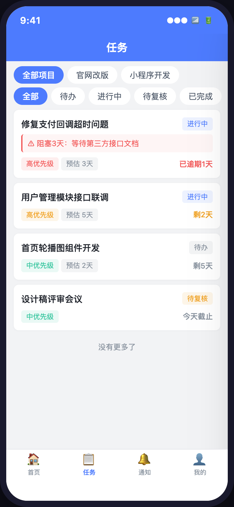

**任务详情** — 阻塞警告、信息展示、状态流转操作、评论

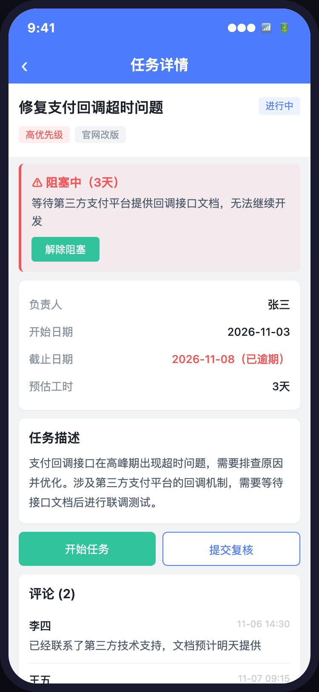

**通知中心** — 未读标记、全部已读

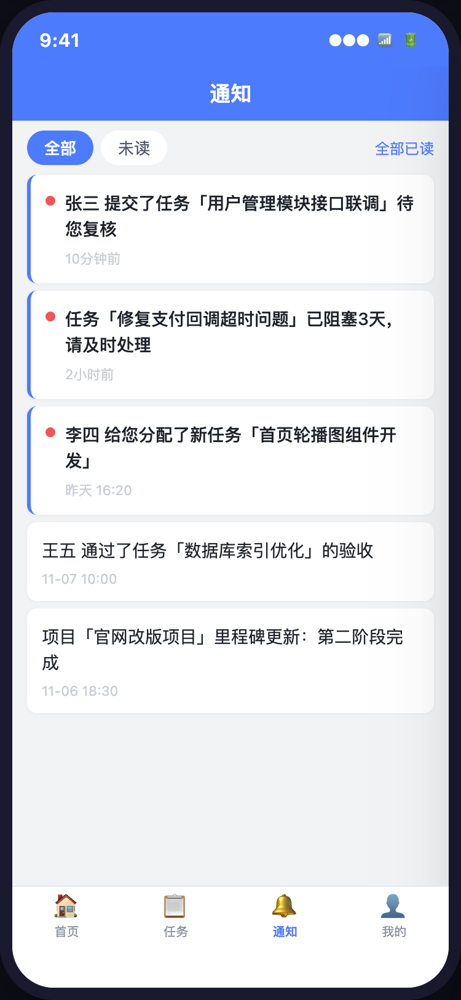

**个人中心** — 用户信息、任务统计、退出登录

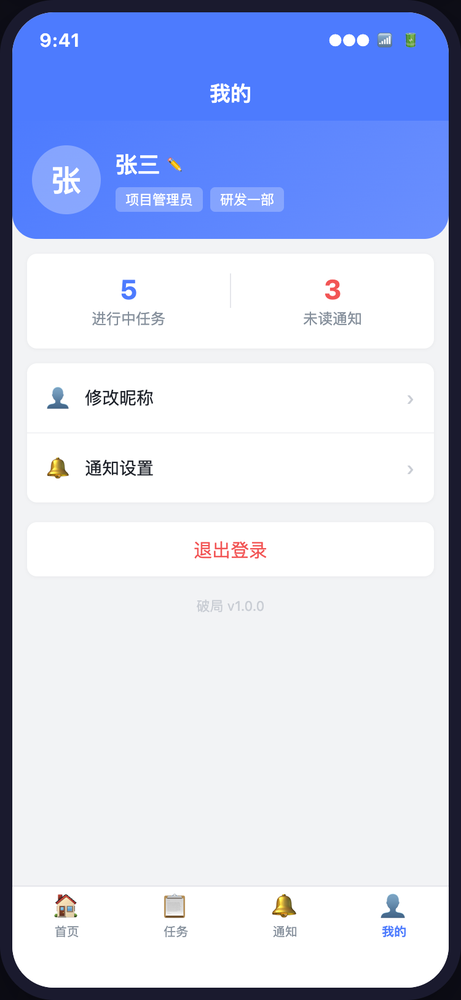

### 任务状态流转

```
待办(1) → 进行中(2) → 待复核(3) → 待验收(4) → 已完成(5) → 已关闭(6)
                ↑         |            |
                └─────────┘            │  (复核/验收不通过 → 返回进行中)
                └──────────────────────┘
```

- 复核不通过 → 返回进行中(2)
- 验收不通过 → 返回进行中(2)
- 关闭需补充关闭证据（closed_evidence）

### 任务角色

| 角色 | 说明 |
|------|------|
| 负责人 (AssigneeID) | 执行任务、标记阻塞 |
| 复核人 (ReviewerID) | 复核任务（状态3→4或→2） |
| 验收人 (AcceptorID) | 验收任务（状态4→5或→2） |
| 创建人 (CreatorID) | 创建任务、关闭任务 |

### AI功能

- **AI任务拆解**：生成子任务建议，经用户确认后创建（AI不能直接创建任务）
- **AI生成描述**：根据任务标题生成任务描述
- **AI推荐负责人**：按未完成任务数推荐最空闲的成员
- **AI周报生成**：根据时间范围内的任务数据生成周报

### 风险评分规则

| 维度 | 分值 |
|------|------|
| 是否阻塞 | +30 |
| 停滞天数 | +5/天（最多+20） |
| 是否逾期 | +25 |
| 后置任务影响数 | +8/个（最多+16） |
| 负责人负载 | +2/个（最多+10） |
| 距截止剩余天数 | ≤1天+15，≤3天+10，≤7天+5 |
| 优先级 | 高+5，中+2 |

风险等级：≥60 高风险 | ≥30 中风险 | <30 低风险

## 项目结构

```
.
├── backend/              # Go 后端
│   ├── config/           # 配置文件
│   ├── internal/
│   │   ├── controller/   # 控制器（9个模块）
│   │   ├── model/        # 数据模型
│   │   └── service/      # 业务逻辑
│   ├── sql/init.sql      # 数据库初始化脚本（11张表）
│   └── main.go
├── frontend/             # Vue 前端
│   └── src/
│       ├── api/          # API层（9个模块）
│       ├── components/   # 共享组件
│       ├── constants/    # 常量定义
│       ├── layout/       # 主布局
│       ├── router/       # 路由
│       ├── store/        # 状态管理
│       ├── utils/        # 工具函数
│       └── views/        # 页面（10+页面）
├── miniprogram/          # 微信小程序
│   ├── pages/            # 页面（6个）
│   ├── utils/            # 工具函数
│   └── app.json          # 小程序配置
└── start.sh              # 一键启动脚本
```

## API 文档

后端API基础路径：`/api/v1`

响应格式：`{ code: 200, message: "...", data: {...} }`

详见后端控制器源码：`backend/internal/controller/`